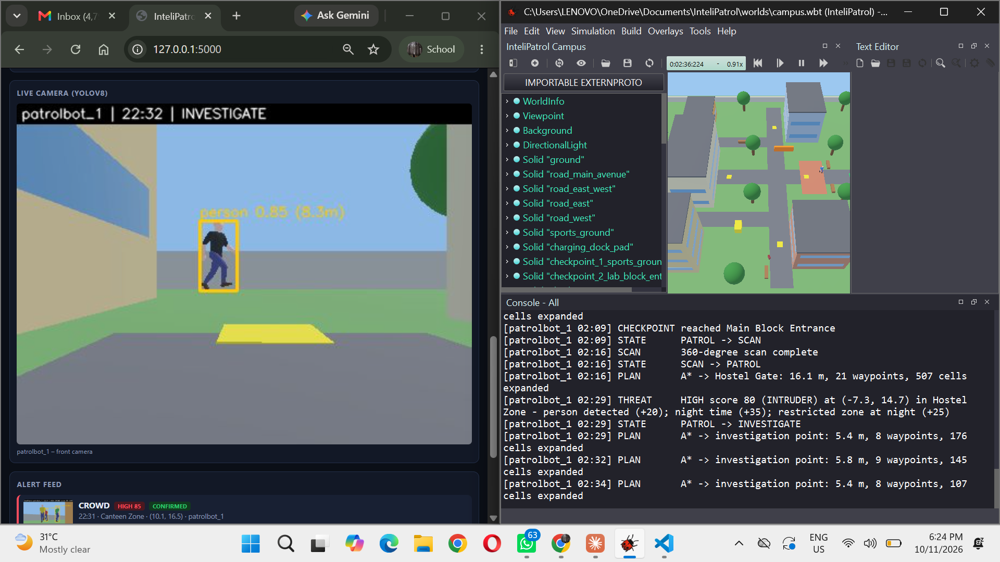
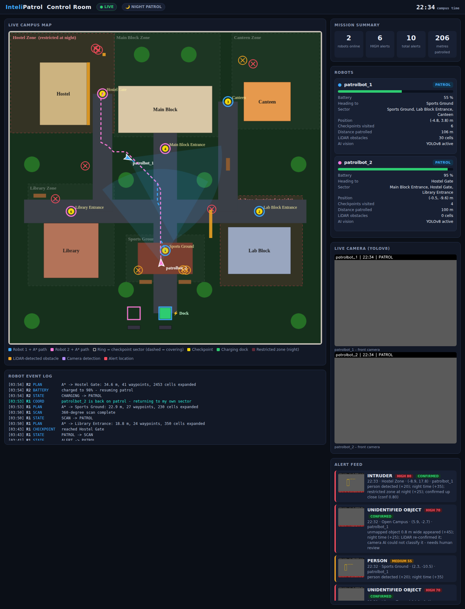

# InteliPatrol: An AI-Based Autonomous Campus Monitoring System

**Intelligent Robotics project · Karunya University**

A fleet of two autonomous security robots patrols a simulated 40 m × 40 m university campus at night. The robots plan their own routes, avoid people and unexpected obstacles, detect intruders, crowds and unattended objects, investigate and confirm threats, and cover for each other while charging. Everything is shown live on a web control-room dashboard.


## Results

| Test | Result |
|---|---|
| Autonomous patrol | **3 full patrol loops, 0 collisions**, with pedestrians on the roads |
| Crowd near the Canteen | Detected (confidence 0.88) → alert |
| Intruder behind the Hostel at night | Detected (confidence 0.91) → investigated → **confirmed HIGH alert** |
| Unattended suitcase | Found by **LiDAR map-change detection** |
| Task reallocation | Robot 1 caught the intruder in Robot 2's sector **while Robot 2 was charging** |
| Moving obstacles | Pedestrians no longer block the map; robots yield, then re-plan |

| Investigating an intruder | Two robots coordinating |
|---|---|
|  |  |

## How it works

Each robot runs a **Sense → Think → Act** loop about 30 times a second.

- **Sense**: GPS, IMU, 360° LiDAR, camera + YOLOv8
- **Think**: update the costmap, plan with A\*, score threats, choose a state
- **Act**: set left and right wheel speeds (skid steering)

### Navigation

| Feature | Where |
|---|---|
| Occupancy grid (0.4 m cells) with 0.65 m obstacle inflation and proximity cost | `costmap.py` |
| A\* path planning (8-connected, octile heuristic, no corner cutting) | `planner.py` |
| Pure-pursuit path following (1.0 m look-ahead) on a skid-steer drive | `patrol_controller.py` → `follow_path` |
| LiDAR mapping of unknown obstacles: persistent (barricade) vs transient (walking person) | `costmap.py` |
| Yield 4 s, then re-plan around a blocked path | `check_replan` |
| Emergency avoidance (< 0.55 m) and stuck recovery | `do_avoid` |
| Battery model: return to dock below 25 %, resume at 98 % | `update_battery` |

### Decision-making

A **finite state machine**: PATROL, SCAN, INVESTIGATE, ALERT, AVOID, RETURN_TO_BASE, CHARGING.

**Explainable threat scoring** (0–100) from base scores plus context: night time, restricted zones, crowd size, unattended objects. 70+ = HIGH (investigate, then alert only if confirmed twice up close), 40–69 = MEDIUM (snapshot and log).

### Perception

| Feature | Where |
|---|---|
| YOLOv8n detection of people and bags | `vision.py` → `Detector` |
| Camera–LiDAR fusion: box → bearing, LiDAR → range → map position | `vision.py` → `locate` |
| LiDAR map-change detection of unknown objects | `check_unknown_objects` |
| Annotated alert snapshots and `alerts.csv` | `raise_alert` |

### Multi-robot fleet

| Feature | Where |
|---|---|
| Two robots, each with its own sector and charging dock | `campus_layout.py` → `FLEET` |
| Shared telemetry "blackboard" (JSON files, read every 1 s) | `coordinate()` |
| Task reallocation while a robot charges | `coordinate()` |
| Shared alert memory: no double investigation | `coordinate()` |
| Deadlock-free yielding (different wait times: 6 s vs 4 s) | `yield_time` |

## How to run

Requirements: [Webots R2025a](https://cyberbotics.com/), Python 3.10.

```bash
pip install -r requirements.txt
```

1. **Dashboard** (terminal, in this folder): `python dashboard/app.py`, then open http://localhost:5000
2. **Simulation**: in Webots, *File → Open World →* `worlds/campus.wbt`, then press ▶ Play

The scenario is a night patrol (campus clock starts at 22:30) with an intruder, a crowd of 3, a walking pedestrian, an unattended suitcase, and a barricade and cart that are not on the robots' map.

## Repository structure

```
InteliPatrol/
├── worlds/campus.wbt              3D campus world
├── protos/PatrolBot.proto         robot: 4 wheels, LiDAR, camera, GPS, IMU
├── controllers/patrol_controller/
│   ├── patrol_controller.py       robot brain: Sense → Think → Act, state machine, fleet
│   ├── campus_layout.py           campus map, checkpoints, zones, docks
│   ├── costmap.py                 occupancy grid + inflation + dynamic obstacles
│   ├── planner.py                 A* path planning
│   ├── vision.py                  YOLOv8 detection + camera–LiDAR fusion
│   └── threat.py                  threat scoring
├── dashboard/                     Flask live control room
├── models/yolov8n.pt              pretrained detector
├── tools/build_world.py           regenerates campus.wbt from the layout
└── docs/                          screenshots and test log
```

## Follow-up project

The vision system was extended in [Vision-Based Autonomous Campus Security Robot](https://github.com/Janicejoyel/VisionSecurityRobot): night enhancement, multi-object tracking, an auto-generated dataset and a custom-trained YOLO model (night mAP@0.5 0.46 → 0.91).
